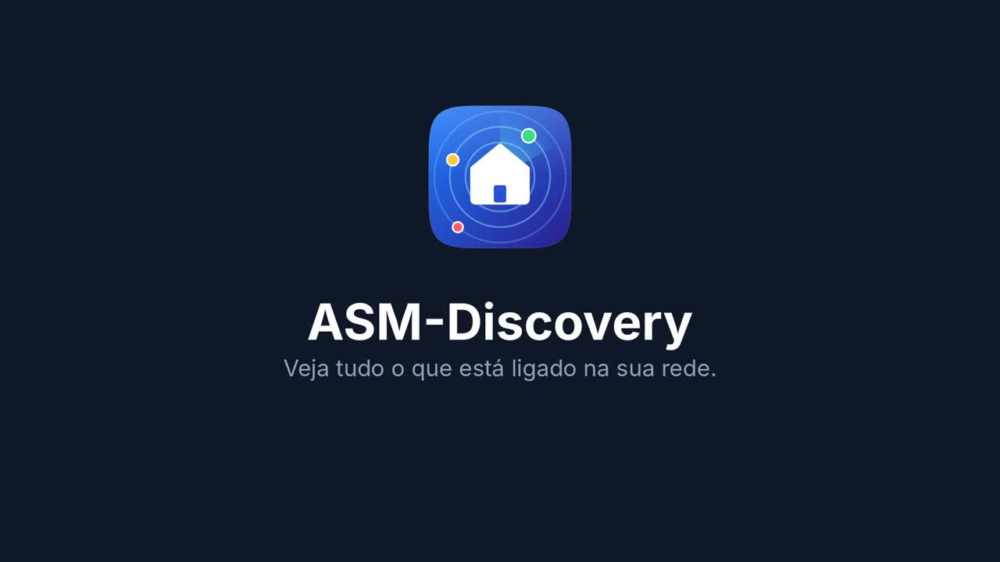

# ASM - Discovery

[](media/ASM-Discovery-demo-v0.8.1.mp4)

**▶ [Assistir ao vídeo de demonstração (2 min 19 s)](media/ASM-Discovery-demo-v0.8.1.mp4)** · *telas ilustrativas da versão 0.8.1*

App gratuito para macOS que **descobre os aparelhos ligados à rede local**, acompanha o que muda neles e **aponta riscos de segurança com explicações diretas**.

Feito para técnicos de TI e suporte que não são especialistas em segurança: quem cuida da rede de casa, de um escritório pequeno ou de um cliente e quer saber **o que está conectado, o que está exposto e o que fazer a respeito**.

> **Versão atual:** 0.8.1 · **Requisito:** macOS 13 (Ventura) ou mais novo · **Licença:** Apache 2.0

*ASM* vem de *Attack Surface Management* (gestão da superfície de ataque): não se protege o que não se sabe que existe.

---

## Baixar e instalar

1. Abra a página de [Releases](../../releases/latest) e baixe o arquivo **`ASM-Discovery-0.8.1.dmg`**.
2. Abra o `.dmg` e arraste o app para a pasta **Aplicativos**.
3. Abra o app. Como ele ainda não é notarizado pela Apple (assinatura *ad-hoc*), o macOS pode bloquear a primeira abertura. Para liberar:
   - clique com o botão direito no app, escolha **Abrir** e confirme; **ou**
   - no Terminal: `xattr -dr com.apple.quarantine /Applications/ASMProto.app`
4. No macOS 15 ou mais novo, clique em **Permitir** quando o sistema perguntar se o app pode encontrar aparelhos na rede local. Sem essa permissão, a lista fica vazia (Ajustes do Sistema › Privacidade e Segurança › Rede Local).

O aplicativo dentro do `.dmg` se chama **ASMProto**; os dados ficam em `~/Library/Application Support/ASMProto/`.

**Conferir o download (SHA-256):**

```
3a37d382cdfd164a15c7ce09bcf0ccc18ed11c04325776128e4495f73f650d73  ASM-Discovery-0.8.1.dmg
```

```bash
shasum -a 256 ASM-Discovery-0.8.1.dmg
```

---

## O que o app faz

| Pergunta | Como o app responde |
|---|---|
| **O que está conectado?** | Varredura leve a cada 10 minutos, sem senha de administrador. Monta o inventário com nome, tipo, IP, MAC e fabricante (ARP, mDNS, SSDP e NetBIOS). |
| **O que mudou?** | Histórico por aparelho e eventos para aparelho novo, aparelho que saiu, porta aberta e MAC trocado. |
| **O que está arriscado?** | A **Central de riscos** verifica configurações perigosas (Telnet, SMBv1, FTP, SNMP com a comunidade "public", UPnP no roteador, certificados vencidos, DNS desconhecido e, se você permitir, a exposição na internet). Cada achado explica o que é, o risco real e o que fazer. |
| **A rede está OK?** | O **Guia do técnico** conduz a verificação em 6 etapas, confere 10 critérios com os dados do app e gera um relatório de uma página para o cliente assinar. |

Outros recursos: atende **várias redes e roteadores** (cada cliente ou unidade fica separado), lista de **aparelhos autorizados**, verificação do **roteador** e da **rede de visitantes**, comparação com a lista do **DHCP** e exportação em **CSV**.

### Análise com IA (opcional)

Com a sua própria chave da API da Anthropic, o app pode analisar um aparelho em detalhe com o Claude. O recurso **vem desligado**: você revisa e edita o texto antes do envio, e nada sai sem o seu clique. A IA apoia a análise; a decisão continua com o técnico.

### O que o app não faz

- Não tenta senhas, não explora falhas e não roda em segundo plano.
- Por padrão, **nada sai do Mac**. A lista completa do que pode sair (e para onde) está na seção *Privacidade* do manual.
- O **Scan ativo** (opcional) exige a confirmação expressa de que o dono da rede autorizou.

---

## Documentação

| Documento | PDF | Word |
|---|---|---|
| **Manual do usuário** (v0.8.1): como usar cada tela, privacidade, perguntas frequentes e glossário | [PDF](docs/Manual-do-usuario-v0.8.1.pdf) | [DOCX](docs/Manual-do-usuario-v0.8.1.docx) |
| **Guia do técnico** (v0.8.1): roteiro de verificação da rede em 6 etapas e os 10 critérios de "rede OK" | [PDF](docs/Guia-do-tecnico-v0.8.1.pdf) | [DOCX](docs/Guia-do-tecnico-v0.8.1.docx) |

---

## Uso responsável

Use o ASM - Discovery **apenas em redes suas ou com autorização do responsável**. Aparelhos frágeis podem travar ou reiniciar durante varreduras ativas; faça o Scan ativo fora de horário crítico.

O app é uma ajuda para enxergar e priorizar. Ele **não substitui** uma consultoria técnica mais profunda, como um teste de intrusão (pentest) profissional.

---

## Licença

Distribuído sob a [Licença Apache 2.0](LICENSE).
